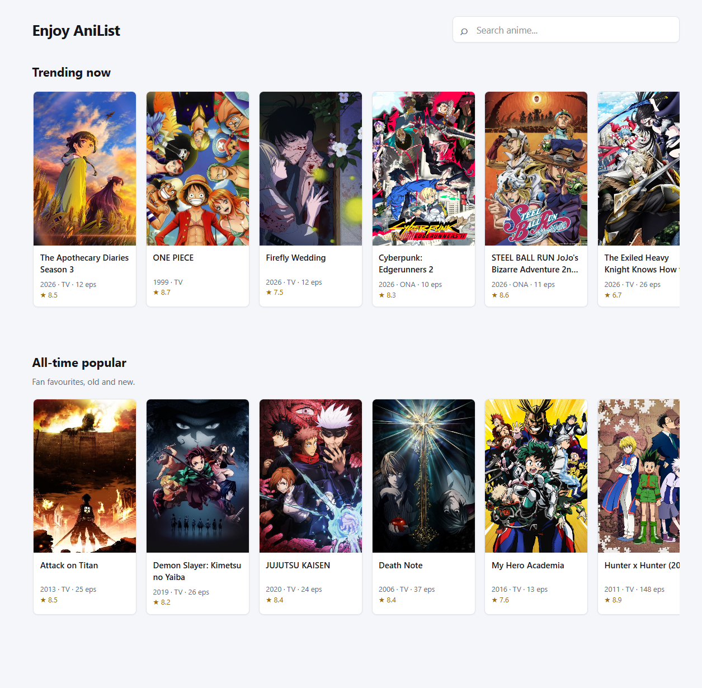
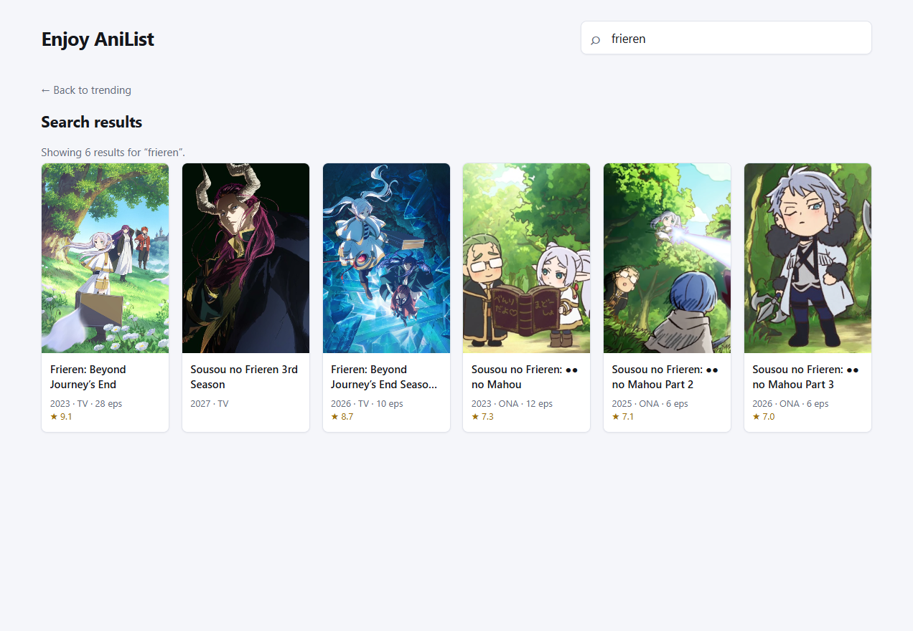
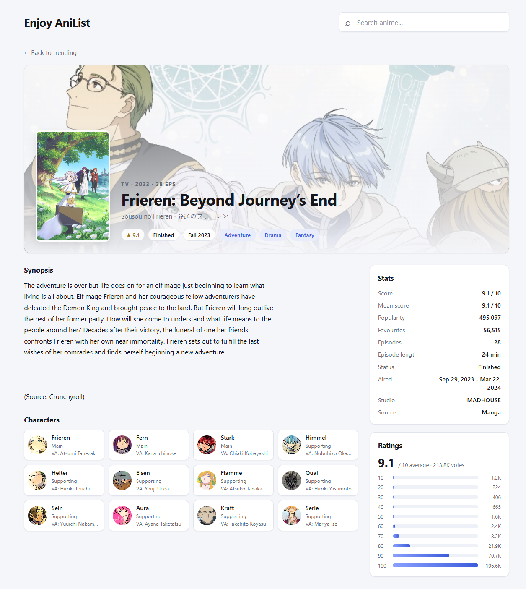

# Enjoy AniList

A small anime discovery site built on the public [AniList](https://anilist.co) GraphQL API. Browse what's trending and what's popular, search for a title, and open a detail page with the synopsis, characters, stats and a rating breakdown.

The frontend is plain HTML, CSS and JavaScript. An Express backend keeps the GraphQL documents and upstream calls on the server, and the browser talks to that backend with Axios.

## Features

- **Trending & popular**: the home page loads both lists through one backend request.
- **Search**: debounced live search, shareable links like `/search?q=frieren`, and "load more" pagination.
- **Anime details**: banner and cover art, synopsis, score and airing info, a stats panel, a rating distribution chart, and the main cast with Japanese voice actors.
- **Express proxy**: the browser only calls `/api`; Express sends the GraphQL requests to AniList with server-side Axios.
- **Light theme**: clean, responsive layout that works down to phone widths.

## Run it locally

Requires [Node.js](https://nodejs.org) 18 or newer.

```bash
npm install
npm start
```

Then open **http://localhost:3000**.

Use `npm run dev` to restart automatically when server files change.

### API endpoints

| Method | Endpoint | Description |
| ------ | -------- | ----------- |
| `GET` | `/api/home?page=1&perPage=15` | Trending and all-time popular anime |
| `GET` | `/api/search?q=frieren&page=1&perPage=15` | Search results plus `pageInfo` |
| `GET` | `/api/anime/:id` | Full detail for one anime |

`page` defaults to `1` and `perPage` to `15` (max `50`). Errors are returned as JSON, for example:

```json
{ "error": "That anime could not be found." }
```

## Project structure

```text
server.js          Express app and AniList GraphQL proxy
public/
  index.html       Trending and popular home page
  search.html      Search results
  anime.html       Anime detail page
  anilist.js       Browser Axios client and shared DOM helpers
  styles.css       Site styles
screenshots/       Reference screenshots
```

## Live demo

Coming soon

## Screenshots

### Home



### Search



### Anime details


